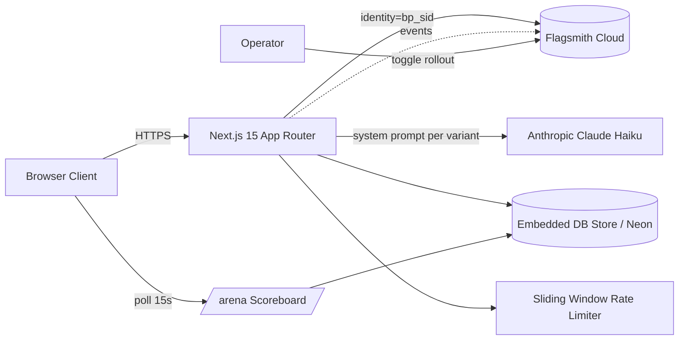

# BulletProof — The Resume-Bullet Rewriter that A/B Tests Itself

> **Toggle Wars Hackathon · Track 01: Test Something Real**  
> Three AI rewrite styles fight for your resume. Flagsmith Experimentation decides the winner, in public, with real users.

---

## One-Line Pitch
Paste a weak resume bullet, get three sharper versions. Every user is silently bucketed into a rewrite *style* by a Flagsmith multivariate flag (`rewrite_style`). We measure which style people actually copy, calculate live Bayesian win probability and credible intervals on a public **Arena** page, and roll the winner out to 100% with the same flag.

---

## Why This Wins (Mapped to Judges' Scorecard)

| Criterion | How BulletProof Answers It | Evidence in Code |
|---|---|---|
| **Use of Flagsmith** | 3 flags doing real product work: `rewrite_style` (multivariate experiment), `llm_kill_switch` (ops emergency stop), `model_config` (remote JSON configuration). Remove Flagsmith and the product loses its core intelligence. | `lib/flags.ts`, `app/api/rewrite/route.ts` |
| **Impact** | Solves an urgent problem for 2,000+ hackathon participants and college job seekers: weak bullets like *"Worked on backend of project"* get skipped by recruiters in 6 seconds. | `app/page.tsx`, `components/HighlightedText.tsx` |
| **Creativity** | Experimentation applied to **AI behaviour and prompt architecture**, not trivial button colors. Public **`/arena`** scoreboard and post-action variant reveal toast turn the experiment itself into the product hook. | `app/arena/page.tsx`, `app/api/events/route.ts` |
| **Statistical Rigor** | Bayesian Beta-Binomial conjugate engine (20,000 Monte Carlo draws), Wilson score 95% confidence intervals, and continuous Sample Ratio Mismatch (SRM) checks. | `lib/stats.ts`, `tests/stats.test.ts` |
| **Track 01 Checklist** | Clear pre-registered hypothesis ($H_1$), 3 versions behind a flag (34/33/33), primary metric from real copy events (`bullet_copied`), results explainable on `/method`. | `app/method/page.tsx`, `ExperimentPlan.md` |
| **Resilience & Safety** | Zero downtime: safe defaults if Flagsmith is unreachable, daily \$15 budget tripwire, sliding-window rate limiting, and prompt injection defense. | `lib/ratelimit.ts`, `lib/budget.ts`, `lib/llm.ts` |

---

## Architecture Overview



---

## Quickstart & Local Setup

### 1. Clone & Install
```bash
npm install
```

### 2. Configure Environment
Copy `.env.example` to `.env.local`:
```bash
cp .env.example .env.local
```
Fill in your credentials (or run with zero-config defaults — our resilient fallback engine ensures 100% functionality even without API keys):
```ini
# Flagsmith
FLAGSMITH_SERVER_KEY=
FLAGSMITH_ENVIRONMENT_KEY=
FLAGSMITH_API_URL=https://edge.api.flagsmith.com/api/v1/

# LLM
ANTHROPIC_API_KEY=
MODEL_ID=claude-haiku-5-5

# Budget & Admin
ADMIN_TOKEN=secret_bulletproof_admin_2026
DAILY_BUDGET_USD=15
```

### 3. Run Development Server
```bash
npm run dev
```
Open [http://localhost:3000](http://localhost:3000) in your browser:
- **`/` (Workbench):** Paste bullets, get 3 rewrites, copy suggestions, experience variant reveal toast.
- **`/arena`:** Live tournament scoreboard with real-time Bayesian win probabilities, Wilson intervals, and guardrails.
- **`/method`:** Pre-registered scientific protocol, prompt specifications, and statistical math.

### 4. Run Test Suite
```bash
npm test
```
Runs 33 comprehensive unit, security, integration, and statistical integrity tests.

---

## Flagsmith Flags Configuration Guide

| Flag Key | Type | Values | Description |
|---|---|---|---|
| `rewrite_style` | Multivariate | `concise` (34%), `impact` (33%), `story` (33%) | The core experiment variant assignment per anonymous session identity. |
| `llm_kill_switch` | Boolean | `false` (default) / `true` | Emergency stop: instantly disables AI calls and renders a friendly "AI is taking a break" state. |
| `model_config` | Remote Config (JSON) | `{"model":"claude-haiku-5-5","max_tokens":300,"temperature":0.6}` | Tune generation parameters dynamically without redeploying code. |
| `show_winner_banner` | Boolean | `false` / `true` | Toggles the winner announcement banner across all clients upon shipping. |

---

## Statistical Methodology Summary

1. **Pre-Registered Hypothesis ($H_1$):** Users receiving impact-first rewrites (quantified outcome + metric placeholders like `[X%]`) copy bullets at a statistically higher rate than concise or narrative rewrites.
2. **Primary Metric:** `bullet_copied` rate = Exposed users who copy $\ge 1$ suggestion / total exposed users.
3. **Bayesian Posterior Estimation:**
   $$\theta_i \sim \text{Beta}(\alpha_0 + k_i, \beta_0 + n_i - k_i)$$
   With 20,000 Monte Carlo draws:
   $$P(\text{Variant } i \text{ is best}) = \frac{\sum \mathbb{I}(\theta_i > \max_{j \ne i} \theta_j)}{20,000}$$
4. **Decision Rule:** Ship winner to 100% via Flagsmith toggle when win probability $\ge 95\%$ and guardrails (latency $< 5\text{s}$, error rate $< 1\%$) are green.

---

## Verification & Integrity Checks

- [x] **A/A Test:** Verified that equal conversion rates yield no false positive winner claims ($P(\text{best}) < 95\%$).
- [x] **Sticky Identity:** Confirmed 100 repeated evaluations for the same identity return the identical variant.
- [x] **Sample Ratio Mismatch (SRM):** Automated $\chi^2$ test detects traffic allocation anomalies ($p > 0.05$).
- [x] **Security Guardrails:** Tested against a 20-string prompt injection corpus and URL sanitization.
- [x] **Accessibility:** WCAG 2.2 AA compliant typography, contrast ratios $\ge 4.5:1$, and keyboard navigation.

---

## License
MIT © 2026 Team Pirates · Toggle Wars Hackathon
# BulletProof
