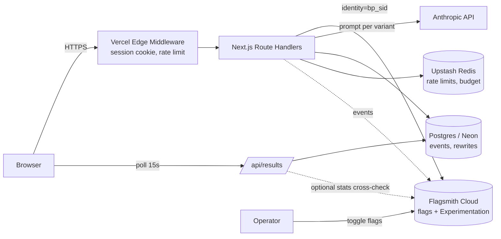
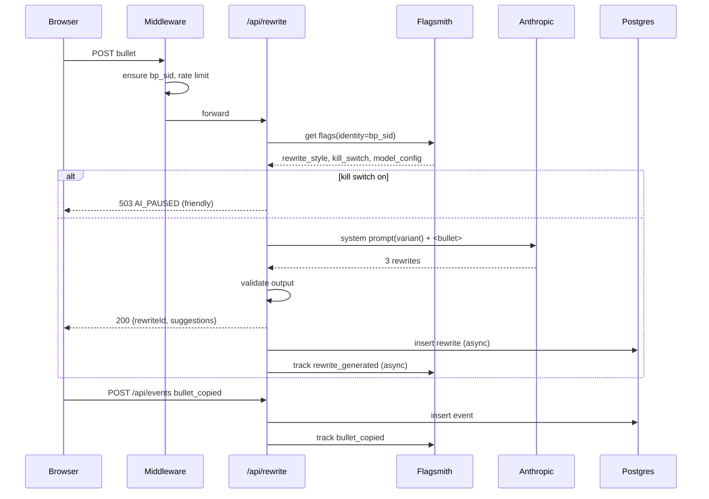

# System Design

## 1. Architecture


## 2. Request flow: generate a rewrite


## 3. Data model (Postgres)
```sql
create table sessions (
  id uuid primary key, created_at timestamptz default now(),
  source text, device text, variant text, first_exposed_at timestamptz
);
create table rewrites (
  id uuid primary key, session_id uuid references sessions(id),
  variant text not null, input_len int, input_hash text,
  output_len int, latency_ms int, model text,
  tokens_in int, tokens_out int, cost_usd numeric(8,6),
  created_at timestamptz default now()
);
create table events (
  id bigserial primary key, session_id uuid references sessions(id),
  rewrite_id uuid, type text not null, variant text not null,
  props jsonb default '{}', created_at timestamptz default now()
);
create index on events (type, variant);
create table budget_ledger (day date primary key, spent_usd numeric(8,4) default 0);
-- optional, opt-in only
create table rewrite_text (rewrite_id uuid primary key, input text, outputs jsonb);
```

## 4. Stats on the Arena page
Flagsmith's engine is the **source of truth** for win probability (screenshot it in the video). The Arena page also shows our own mirror so it is live and public:
- Per-variant counts: exposed, copied, copy rate, Wilson 95% interval.
- Bayesian Beta-Binomial: Beta(1,1) prior; Monte Carlo (20k draws) for P(best) and expected lift vs control.
- A label "Mirror of Flagsmith results, computed from our event log" for transparency. If the two disagree materially, investigate (a bug or an ingestion gap is itself a finding).

## 5. Reliability and degradation matrix
| Failure | Behaviour |
|---|---|
| Flagsmith unreachable | Use cached flags (TTL 60s), else defaults (`concise`); log `flag_fallback`; exclude those sessions from analysis |
| LLM timeout (>8s) | One retry on faster config; then friendly error with retry |
| LLM invalid output | Re-ask once; else fallback error |
| DB down | Generation still works; events buffered best-effort and dropped with a log |
| Redis down | Fail open on per-session limit but keep an in-memory limiter |
| Budget exceeded | Auto-flip `llm_kill_switch` (via Flagsmith API) and show "back tomorrow" |

## 6. Scaling
Stateless serverless handlers scale horizontally; the bottleneck is LLM rate limits. Mitigations: streaming, short prompts, request coalescing, and a budget cap. DB writes are small and async. Expected peak is under 5 RPS; design headroom 50 RPS.

## 7. Privacy by design
No accounts, no raw text retention by default, hashed inputs only (SHA-256 with salt), aggregated public data only, deletion route for opt-in text, and clear `/method` disclosure.

## 8. Observability
Structured JSON logs (`requestId, sessionId, variant, latencyMs, outcome`), Arena "freshness" timestamp, `/api/health` checks for flags, DB, and LLM, and a daily cost line in logs.

## 9. Stretch (Track 02/03 crossover, only if ahead of schedule)
Use Flagsmith's MCP server or CLI from Claude Code to create the flag, metric and experiment with human approval; document the exact prompt used in the README (it shows "AI plus flags" without building a second product).
